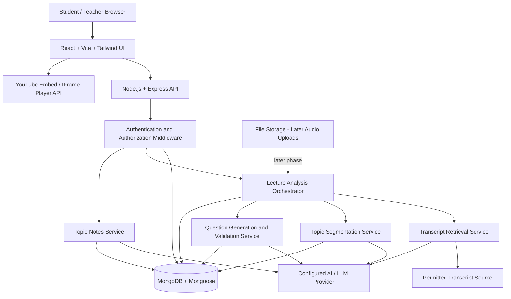
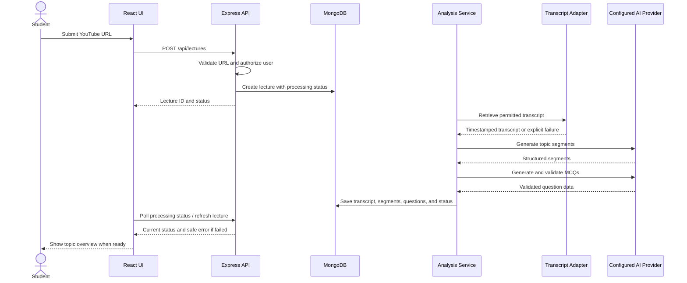
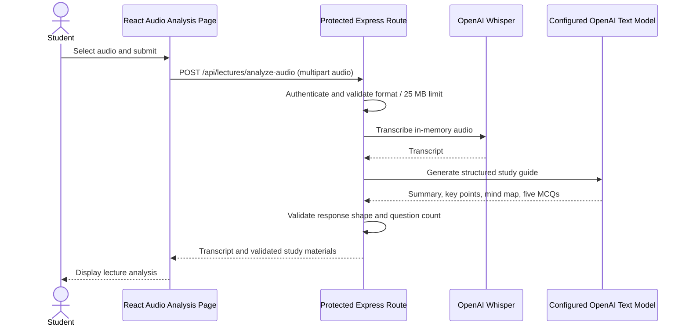

# LectureLoop — System Architecture

**Document type:** Architecture and design reference  
**Status:** Initial architecture proposal; validate against the actual repository before implementation  
**Related documents:** `PRD.md`, `requirement.md`

---

## 1. Purpose

This document describes the proposed system architecture for LectureLoop: the main application layers, data flow, services, data entities, security boundaries, and integration points.

**Important for the AI coding agent:** This is a target architecture, not proof that these components already exist. First inspect the repository and Stitch-generated UI. Reuse the existing architecture and components where possible, and adapt this document to the actual codebase. Do not create duplicate apps, routers, layouts, or services unnecessarily.

## 2. Architecture Goals

- Keep the dashboard and Interactive Learning module within one cohesive application.
- Separate presentation, API handling, business rules, data persistence, and external AI integrations.
- Support the complete YouTube lecture learning loop.
- Persist lecture processing status, questions, attempts, and learning progress.
- Keep oral practice in the authenticated workspace, with account-scoped history.
- Isolate external provider dependencies so they can be changed without rewriting the UI.
- Handle slow processing and external failures without losing saved state.
- Leave clear extension points for classroom audio, oral assessment, mind maps, teacher tools, and research evaluation.

## 3. High-Level Architecture



### 3.1 Layer responsibilities

| Layer | Responsibility |
|---|---|
| Browser/UI | Render screens, manage interaction state, embed the official YouTube player, call APIs, and display errors/progress. |
| Frontend API client | Centralize base URL, request handling, authentication headers where applicable, and consistent error parsing. |
| Express API | Validate requests, authorize access, invoke business services, and return safe response DTOs. |
| Business services | Own lecture lifecycle, segmentation, question validation, answer checking, remediation policy, and session progression. |
| AI/transcript adapters | Integrate with configured transcript and AI providers behind stable internal interfaces. |
| MongoDB/Mongoose | Persist users (if auth exists), lectures, transcripts, segments, questions, sessions, attempts, and notes. |
| External providers | Supply permitted transcript retrieval, transcription, and language-model capabilities. |
| YouTube player | Play the source video through the official embed and seek/play/pause at topic timestamps. |

### 3.2 Oral practice

Oral practice is part of the protected LectureLoop workspace at `/oral-practice`.
It reuses the signed-in user's lecture topics as source material, accepts pasted
notes, and stores answer attempts under the authenticated account in MongoDB.
Browser speech recognition is preferred; recorded audio can use the server-side
OpenAI transcription adapter when `OPENAI_API_KEY` is configured. OpenAI-powered
questions, answer feedback, and language help are optional; when no key is set,
the app uses clearly labeled local prompts and heuristic scores. Provider errors
are surfaced rather than silently presented as successful AI results.

## 4. Proposed Technology Choices

Use the repository's actual working stack first. The expected direction is:

- **Frontend:** React, Vite, JavaScript, Tailwind CSS, existing router and UI conventions.
- **Backend:** Node.js and Express.
- **Database:** MongoDB and Mongoose.
- **Video playback:** YouTube embedded player and IFrame Player API.
- **AI:** Provider-neutral adapters for transcript retrieval, segmentation, MCQ generation/validation, and notes.
- **Deployment:** Keep the existing configuration unless a change is necessary and documented.

Do not add a new framework or state-management library simply because it appears in this document. Use existing dependencies where appropriate.

## 5. Suggested Repository Organization

Adapt the structure to the repository; do not move files solely to match this example.

```text
project-root/
├── PRD.md
├── requirement.md
├── architecture.md
├── README.md
├── .env.example
├── package.json                 # if the repository uses a root package
├── client/                      # or existing frontend folder
│   ├── package.json
│   └── src/
│       ├── components/
│       │   ├── layout/
│       │   ├── ui/
│       │   ├── lectures/
│       │   └── learning/
│       ├── pages/
│       ├── routes/
│       ├── services/
│       │   └── apiClient.js
│       ├── hooks/
│       ├── context/              # only if needed / already used
│       ├── utils/
│       └── assets/
└── server/                      # or existing backend folder
    ├── package.json
    └── src/
        ├── app.js
        ├── server.js
        ├── routes/
        ├── controllers/
        ├── middleware/
        ├── models/
        ├── validators/
        ├── services/
        │   ├── lectureService.js
        │   ├── transcriptService.js
        │   ├── segmentationService.js
        │   ├── questionService.js
        │   ├── notesService.js
        │   └── sessionService.js
        └── utils/
```

### Structure rules

- Keep one canonical frontend app and one canonical backend app.
- Reuse the Stitch UI components and assets rather than copying them into parallel folders.
- Keep controllers thin; put business rules in services.
- Keep provider-specific code out of UI components and route handlers.
- Avoid circular imports and multiple implementations of the same business rule.
- Use naming and module conventions already established by the repository.

## 6. Main Runtime Flows

### 6.1 Create and analyze a YouTube lecture



The implementation may run analysis synchronously for a short local prototype, but the processing state must be persisted. For longer jobs, use a background worker or queue when justified. Do not rely on a browser request remaining open for the full analysis.

### 6.1.1 Analyze uploaded lecture audio

The authenticated audio-analysis flow accepts one audio file up to 25 MB in a supported format. The Express route validates the upload in memory, sends it to OpenAI Whisper for transcription, then requests a summary, key points, mind map data, and exactly five validated multiple-choice questions from the configured text model. The browser displays the returned transcript and study materials. The OpenAI API key remains in the server environment; uploaded files and generated results are not persisted by this flow.



### 6.2 Interactive learning session

```mermaid
sequenceDiagram
    actor Student
    participant UI as Learning Session UI
    participant YT as YouTube Player
    participant API as Express API
    participant DB as MongoDB
    participant Notes as Notes Service

    Student->>UI: Start or resume session
    UI->>API: Create/get session
    API->>DB: Load saved progress
    API-->>UI: Current topic and safe question
    UI->>YT: Seek to topic start and play
    YT-->>UI: Player state/time updates
    UI->>YT: Pause at topic end
    UI-->>Student: Show topic question
    Student->>UI: Select answer and submit
    UI->>API: POST answer attempt
    API->>DB: Load question and session; verify ownership
    API->>API: Calculate correctness and attempt policy
    API->>DB: Save attempt and progress state
    API-->>UI: Outcome, feedback, and next action
    alt Incorrect and retry available
        UI->>API: Get topic notes if not cached
        API->>Notes: Generate transcript-grounded notes
        Notes->>DB: Save notes
        API-->>UI: Notes and replay instructions
        UI-->>Student: Show targeted replay, notes, and retry
    else Correct or attempts exhausted
        UI-->>Student: Offer next topic or results
    end
```

### 6.3 Resume a session

1. The UI requests the session by ID.
2. The server verifies ownership and loads the saved state.
3. The server returns the current topic, completed topics, attempt count, and safe question payload.
4. The UI restores the appropriate player timestamp and learning state.
5. The student continues without resetting prior attempts.

## 7. Frontend Architecture

### 7.1 Shared application shell

The existing dashboard and Interactive Learning module must share:
- One sidebar/navigation implementation.
- One header/top bar pattern.
- Shared page containers and design tokens.
- Shared buttons, cards, badges, forms, dialogs, and status components.
- Consistent responsive breakpoints and accessibility behavior.

The Stitch-generated code is the UI starting point. Inspect and reuse its actual components, CSS, assets, and page layouts. Do not create a separate shell for the learning module.

### 7.2 Page responsibilities

Names are illustrative; retain existing routes where possible.

| Page | Responsibility |
|---|---|
| Dashboard | Overview, recent lectures, primary Add Lecture action, real progress summaries. |
| Interactive Learning | Entry point to create, browse, or resume learning. |
| Add Lecture | URL/title/subject input and validation. |
| Lecture Processing | Processing stage, errors, retry action. |
| Topic Overview | Lecture metadata and ordered topic segments. |
| Learning Session | Player, topic progress, MCQ, feedback, notes, retry, continue. |
| Session Results | Persisted performance summary and weak-topic review links. |
| My Lectures | Saved lecture library and status. |
| Future placeholders | Clearly label unimplemented modules rather than presenting inert controls as working features. |

### 7.3 Frontend service boundary

Components should call a shared API client or feature service, not construct scattered raw `fetch` calls. Suggested feature services:
- `lectureApi`
- `sessionApi`
- `questionApi`
- `notesApi`

Follow the existing project's patterns if it already has an API layer.

### 7.4 UI state

Represent these states explicitly:
- `idle`
- `loading`
- `processing`
- `ready`
- `submitting`
- `remediation`
- `completed`
- `failed`

Use the state names that best fit the current code. The goal is to avoid ambiguous boolean combinations and prevent duplicate submissions.

## 8. Backend Architecture

### 8.1 Request path

Typical request flow:

1. Express route receives request.
2. Validation middleware validates path/body/query.
3. Authentication middleware identifies the user where authentication exists.
4. Authorization/service logic verifies resource ownership.
5. Controller invokes a business service.
6. Service reads/writes via Mongoose models and calls provider adapters when required.
7. Controller returns a safe, documented response shape.

### 8.2 Suggested service boundaries

- **Lecture service:** create/list/get/delete lecture records, validate source metadata, track status.
- **Analysis orchestrator:** coordinate transcript retrieval, segmentation, question generation, and failure recovery.
- **Transcript service:** extract permitted YouTube audio and transcribe it with a configured speech recognition provider.
- **Segmentation service:** convert transcript text and timestamps into validated topic segments.
- **Question service:** generate and validate questions and keep answer keys server-side.
- **Session service:** create/resume sessions, record attempts, calculate correctness, apply retry policy, advance topics, and finish sessions.
- **Notes service:** generate and cache notes grounded in the selected segment.
- **Analytics service (later):** calculate teacher/class aggregates and research metrics.

Avoid placing all logic in one controller or one oversized service.

## 9. Analysis Pipeline and Status Model

### 9.1 Pipeline stages

1. Validate source URL and extract video ID.
2. Create a persisted lecture record.
3. Retrieve transcript using a permitted method.
4. Normalize transcript units and timestamps.
5. Segment transcript into topics.
6. Validate topic titles, order, boundaries, and timestamp ranges.
7. Generate questions from each segment.
8. Validate question structure, answer key, relevance, and evidence.
9. Save the results and mark the lecture ready.

### 9.2 Suggested lecture states

- `draft`
- `queued` (if a queue is used)
- `processing`
- `ready`
- `failed`

Track a separate `processingStage`, for example:
- `validating_source`
- `retrieving_transcript`
- `segmenting_topics`
- `generating_questions`
- `validating_questions`
- `saving_results`

Do not show a percentage unless the underlying work can measure meaningful progress.

### 9.3 Failure handling

- Persist a sanitized error and failed stage.
- Preserve successfully completed earlier stages.
- Allow a safe retry from the failed stage where practical.
- Limit provider retries and use timeouts.
- Avoid duplicate analysis jobs for repeated submissions.
- Never mark a lecture ready if required segments/questions are invalid or missing without explicitly recording that partial status.

## 10. Data Architecture

The following are logical entities. Map them to existing Mongoose models and conventions.

### User
Identity, role, and authentication fields if authentication is implemented. Passwords must be hashed, never stored as plaintext.

### Lecture
Owner, source type, canonical URL/video ID, title, subject, duration, status, processing stage/error, transcript reference, analysis version, timestamps.

### Transcript
Lecture reference, source method, language metadata, timestamped units, full text or chunk references, processing status, timestamps.

### TopicSegment
Lecture reference, order, title, description, start/end seconds, transcript text/reference, key concepts, status.

### Question
Lecture and segment references, type, question text, options, correct option ID, explanation, supporting evidence, validation status, optional difficulty.

### LearningSession
Owner, lecture reference, status, current segment, completed segment IDs, weak segment IDs, start/completion/last activity timestamps.

### AnswerAttempt
Owner, session/lecture/segment/question references, selected option ID, server-calculated correctness, attempt number, optional time spent, submission timestamp.

### TopicNotes
Lecture/segment reference, owner if personalized, title, key points, definitions, examples, misconceptions, source evidence, timestamps.

### Data rules

- Store references consistently and validate relationships.
- Index frequently queried owner/status/lecture/order fields.
- Avoid unbounded embedded arrays for large transcripts.
- Use safe response DTOs rather than returning database documents directly.
- Never send a question's correct answer to the browser before submission.
- Calculate session metrics from saved attempts.

## 11. API Boundary

Use the repository's existing URL conventions if established. Suggested endpoints:

| Method | Endpoint | Purpose |
|---|---|---|
| POST | `/api/lectures` | Create lecture from YouTube URL. |
| GET | `/api/lectures` | List current user's lectures. |
| GET | `/api/lectures?date={YYYY-MM-DD}&subject={subject}` | List uploaded IoT recordings filtered by date and/or subject (authenticated). |
| POST | `/api/iot/upload-audio` | Store an MP3 from a Pi and persist audio metadata (requires `x-device-token`). |
| POST | `/api/iot/upload` | Store a daily attendance CSV and its MP3 recordings as one idempotent device batch (requires `x-device-token`). |
| GET | `/api/lectures/:lectureId` | Get lecture details/status. |
| POST | `/api/lectures/:lectureId/analyze` | Start/retry analysis. |
| GET | `/api/lectures/:lectureId/processing-status` | Check processing state. |
| GET | `/api/lectures/:lectureId/segments` | Get ordered topic segments and safe question metadata. |
| POST | `/api/lectures/:lectureId/sessions` | Create/resume learning session. |
| GET | `/api/sessions/:sessionId` | Load session progress. |
| POST | `/api/sessions/:sessionId/answers` | Submit answer and record attempt. |
| POST | `/api/sessions/:sessionId/continue` | Resolve current topic and advance. |
| GET | `/api/sessions/:sessionId/results` | Get persisted results. |
| GET | `/api/segments/:segmentId/notes` | Get/generate topic notes. |
| POST | `/api/teacher/upload-timetable` | Teacher uploads an `.xlsx` timetable; validated rows are stored for device lookup. |
| GET | `/api/device/timetable?device_id={deviceId}&day={day}` | Return the selected device's entries for the requested day as JSON. |

API rules:
- Validate all request input on the server.
- Enforce ownership checks.
- Calculate correctness server-side.
- Use consistent JSON shapes and HTTP status codes.
- Return safe error messages without stack traces or secrets.
- Avoid duplicate jobs and duplicate attempts.
- Add pagination for growing collections.
- Validate timetable workbook columns and schedule values before saving; associate uploaded entries with the authenticated teacher.

Single IoT audio uploads use multipart fields `audio` (MP3), `subject`, `date` (`YYYY-MM-DD`), `device_id`, and `duration` (seconds), plus the configured `x-device-token` header. Daily IoT batches use `attendance` (CSV), repeated `audios` (MP3), `device_id`, `date`, and an `audio_metadata` JSON map of filenames to subject/date/device/duration values. CSV files are stored under `server/uploads/attendance/`, audio files under `server/uploads/audios/`; the authenticated lecture query returns metadata, not audio bytes.

## 12. YouTube Player Architecture and Constraints

- Use the official YouTube embedded player and IFrame Player API.
- Store segment timestamps in seconds.
- Seek to the selected segment's start time when the student begins or replays a topic.
- Observe player state/time and pause at the segment end.
- Prevent stale callbacks from a previous topic from pausing the newly selected topic.
- Reset boundary monitoring when changing segments.
- Handle player ready, buffering, paused, ended, and error states.
- Keep quiz submission independent of player callback timing.
- Test with real embeddable videos and edge cases.
- Do not download or rehost video content.
- Some videos may disable embedding or audio extraction. Display clear recovery guidance.

The player API does not by itself provide the complete adaptive-learning flow. Topic-boundary handling, quiz presentation, progress saving, and remediation must be implemented by LectureLoop.

## 13. AI Integration Architecture

### 13.1 Provider adapters

Create narrow, testable interfaces for:
- Transcript retrieval
- Audio transcription (future phase)
- Topic segmentation
- MCQ generation
- MCQ validation
- Topic notes generation

Provider-specific request/response formats should be normalized within adapter/service code, not leaked into React components.

### 13.2 Structured output validation

AI responses must be parsed and validated before saving. Validate:
- Required fields and types.
- Valid timestamp ranges and ordering.
- Exactly one correct option for single-select MCQs.
- Non-empty, non-duplicate options.
- Transcript support for answer/explanation.
- Topic relevance.
- Length limits and unexpected output.

Treat model output as untrusted. Retry a limited number of times; then return a safe failure or mark the affected question unavailable.

### 13.3 Grounding and evidence

Store an evidence excerpt or transcript reference for each question and relevant note. Avoid unrelated general knowledge. If an example extends beyond the transcript, label it as an illustrative example rather than claiming the lecturer said it.

### 13.4 Caching and versioning

- Reuse valid analysis for the same video when appropriate.
- Track analysis/prompt/schema versions when reprocessing is possible.
- Avoid repeating expensive calls after a later pipeline stage fails.
- Invalidate dependent questions/notes if the underlying segment changes.
- Do not overwrite learner attempts without an explicit migration/reanalysis policy.

## 14. Security and Privacy Boundaries

- API keys remain server-side in environment variables.
- Validate and authorize every user-specific resource request.
- Do not trust client-supplied user IDs, correctness flags, attempt numbers, or progress values.
- Rate-limit expensive processing endpoints as appropriate.
- Sanitize displayed user text and provider errors.
- Do not expose correct answers before submission.
- Avoid logging secrets, tokens, raw audio, or unnecessary transcript content.
- Do not collect camera/face data.
- For later audio recording, require appropriate lecturer permission and participant consent.
- Define retention and deletion behavior for lectures, transcripts, attempts, and notes.
- Research exports must be consent-based and anonymized.

## 15. Configuration and Deployment

Use the current repository's deployment approach. Suggested environment variables, only if applicable:

```env
NODE_ENV=development
PORT=5000
MONGODB_URI=
CLIENT_ORIGIN=http://localhost:5173
OPENAI_API_KEY=
OPENAI_MODEL=gpt-4.1-mini
GEMINI_API_KEY=
GEMINI_MODEL=gemini-2.5-flash
GROQ_API_KEY=
GROQ_TRANSCRIPTION_MODEL=whisper-large-v3-turbo
# TRANSCRIPTION_API_KEY=
```

Requirements:
- Commit `.env.example`, never real `.env` credentials.
- `OPENAI_API_KEY` (or legacy `OPEN-AI-API`) is used first for server-side transcript analysis; `GEMINI_API_KEY` is used if OpenAI fails. Model IDs can be overridden with `OPENAI_MODEL` and `GEMINI_MODEL`.
- `GROQ_API_KEY` (or legacy `WISPER_API_KEY`) can be used for audio transcription. The server extracts audio with yt-dlp and sends it to Groq Whisper; the current upload limit is 25 MB. Only use this for videos you are authorized to download and transcribe.
- Install server dependencies with Python 3.9+ available for the yt-dlp wrapper's installation.
- Set `IOT_UPLOAD_TOKEN` to a strong shared device token before accepting Raspberry Pi audio uploads.
- Raspberry Pi audio processing requires the dependencies in `iot_device/audio/requirements.txt`, PortAudio for microphone capture, and FFmpeg for MP3 export.
- Document where each variable is used.
- Keep local frontend and backend origins configurable.
- Configure CORS for approved origins.
- Provide a health endpoint if the backend architecture supports it.
- Do not assume provider access is available just because an environment variable name is documented.

## 16. Observability and Error Handling

Log:
- Request/job identifiers.
- Processing stage transitions.
- Duration and success/failure of external calls.
- Sanitized error codes and messages.

Do not log:
- API keys, tokens, passwords.
- Unnecessary personal data.
- Full audio or transcript contents unless explicitly required for controlled debugging and privacy-safe.

User-facing error categories should distinguish:
- Invalid source
- Transcript unavailable
- Provider configuration missing
- Provider timeout/rate limit
- Invalid AI output
- Processing failure
- Unauthorized/not found
- Player/embed unavailable
- Network error

Provide safe retries and preserve saved state wherever possible.

## 17. Testing Strategy

### Unit tests
- URL/video ID validation.
- Segment timestamp and ordering validation.
- MCQ schema and correct-answer validation.
- Server-side answer checking.
- Attempt policy transitions.
- Session progression.
- Safe DTO serialization.

### Integration tests
- Lecture creation and ownership.
- Processing status persistence.
- Transcript/AI provider failure behavior.
- Answer submission and persisted attempt records.
- Session resume.
- Results calculation.
- Authorization for lectures and sessions.

### UI/manual tests
- Shared shell and navigation.
- Desktop/tablet/mobile layouts.
- Processing, empty, and failure states.
- Video segment seek and boundary pause.
- Quiz submit, remediation, retry, continue, and results.
- Refresh during processing and during a learning session.

Use the existing testing tools when available. Do not add a new testing framework without a clear need.

## 18. Phased Implementation

### Phase 0 — Audit
Inspect the actual repository and Stitch UI. Map existing files and components to this architecture. Report gaps before editing.

### Phase 1 — Unified UI
Connect dashboard and learning module through one shell and consistent navigation. Reuse components and preserve the visual design.

### Phase 2 — Lecture records
Implement database-backed lecture creation/listing/details and URL validation.

### Phase 3 — Processing pipeline
Implement transcript retrieval, segmentation, question generation/validation, persisted statuses, and recovery.

### Phase 4 — Learning sessions
Implement player boundary control, quizzes, server-side answer checking, remediation, notes, and session persistence.

### Phase 5 — Results and hardening
Implement results, weak-topic review, tests, error handling, authorization, documentation, and responsive checks.

### Later phases
Add classroom audio, improved Hinglish transcription, oral assessment, personalized mind maps, teacher tools, revision reminders, and research evaluation.

## 19. Architecture Decisions to Confirm During Repository Audit

Do not guess these items. Discover and report them:
- Actual frontend and backend folder names.
- Whether backend and MongoDB are already implemented.
- Existing authentication approach.
- Existing router and state-management conventions.
- Existing AI provider and transcript retrieval approach.
- Existing deployment targets.
- Whether analysis should initially run inline or in a background job.
- Whether the current UI uses mock data or persisted API data.

Document any deviation from this proposal and explain why it is the smallest safe choice.

## 20. Definition of Done

Architecture is considered implemented for the MVP when:
- One application shell serves dashboard and learning pages.
- UI, backend business logic, persistence, and external integrations have clear boundaries.
- Lecture analysis stages and failures are persisted.
- Questions are validated and answer keys stay server-side.
- Session attempts and progress persist and can be resumed.
- The player seeks to topic timestamps and boundary behavior is tested.
- Provider failures do not cause false success or data loss.
- Ownership checks protect user data.
- Tests cover critical business rules.
- Setup, environment variables, limitations, and architecture choices are documented.

**Core architecture priority:** support a reliable flow from lecture URL to grounded topic segments, quiz, targeted remediation, persisted progress, and session results. All other capabilities should extend that foundation rather than create a separate product.
